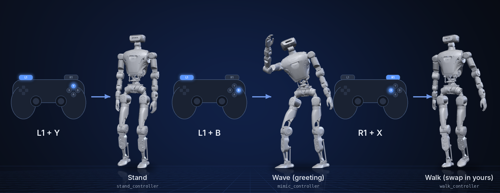

<p align="center">
  
</p>

<p align="center">
  <b>English</b> | <a href="README_cn.md">中文</a>
</p>

<p align="center">
  <a href="LICENSE"></a>
  
  
  
</p>

# humanoid-rl-deploy-python

Deploy RL policies on the LimX humanoid in plain Python: stand, wave and walk
controllers that run ONNX policies, switched from the remote controller, in
the MuJoCo simulator or on the real robot.

> **Scope:** the deployment side only. Policies are trained elsewhere and
> exported to ONNX; the simulator is
> [humanoid-mujoco-sim](https://github.com/limxdynamics/humanoid-mujoco-sim).
> For the ROS 2 version, see
> [humanoid-rl-deploy-ros2](https://github.com/limxdynamics/humanoid-rl-deploy-ros2).

## Highlights

- **No ROS, no build.** Python 3, `limxsdk` and ONNX Runtime; run `main.py`.
- **Remote-controlled modes.** `L1 + Y` stand, `L1 + B` greeting motion,
  `R1 + X` walk, `L1 + A` damping.
- **Bring your own walking policy.** Drop a `policy.onnx` into
  `walk_controller/policy/default/`; the controller feeds it joystick velocity
  commands.
- **One controller per file.** Each mode is a small `BaseAbility` class
  (80 to 340 lines) listed in `controllers/<ROBOT_TYPE>/controllers.yaml`.
- **Same code for sim and robot.** `main.py` connects to `127.0.0.1` by
  default and to the robot with `main.py 10.192.1.2`.

## Supported robots

| | Model | Description | Controllers | Policy format |
|:-:|---|---|---|---|
|  | `HU_D04_01` | Full-size humanoid, 31 joints | stand, mimic (greeting), walk, damping | ONNX |
|  | `HU_D03_03` | Previous generation, discontinued | stand, mimic (greeting), damping | ONNX |

## What it does

<p align="center">
  
</p>

## Quick start

In simulation, with [humanoid-mujoco-sim](https://github.com/limxdynamics/humanoid-mujoco-sim)
in the same folder (Linux x86_64):

```bash
cd ~/limx_ws
pip install humanoid-mujoco-sim/limxsdk-lowlevel/python3/amd64/limxsdk-*.whl click
export ROBOT_TYPE=HU_D04_01

python humanoid-mujoco-sim/simulator.py            # terminal 1
python humanoid-rl-deploy-python/main.py           # terminal 2
humanoid-mujoco-sim/robot-joystick/robot-joystick  # terminal 3
```

In the virtual joystick, hold `Q` (L1) and press `I` (Y) to stand, then `L`
(B) to wave. `click` is needed by `limxsdk.ability.cli`, which `main.py` uses to
load and switch controllers, but the limxsdk wheel does not install it.

## 1. Create a Workspace

 You can create an RL deployment development workspace by following these steps:

- Open a Bash terminal.

- Create a new directory to store the workspace. For example, create a directory named "limx_ws" in the user's home directory:
  ```Bash
  mkdir -p ~/limx_ws
  ```
  
- Download the MuJoCo simulator:
  ```Bash
  cd ~/limx_ws
  git clone --recurse git@github.com:limxdynamics/humanoid-mujoco-sim.git
  ```
  
- Download the motion control algorithm:
  ```Bash
  cd ~/limx_ws
  git clone git@github.com:limxdynamics/humanoid-rl-deploy-python.git
  ```
  
- Set the robot model: If it is not set yet, follow these steps:
  - Set the robot model type:

    ```
    echo 'export ROBOT_TYPE=HU_D04_01' >> ~/.bashrc && source ~/.bashrc
    ```

## 2. Simulation Debugging

- Run the MuJoCo simulator (Python 3.8 or higher is recommended):

  - Open a Bash terminal.

  - Install the motion control development library:
    - For Linux x86_64 environment:
    
      ```bash
      cd ~/limx_ws
      pip install humanoid-mujoco-sim/limxsdk-lowlevel/python3/amd64/limxsdk-*.whl
      ```
    
    - For Linux aarch64 environment:
    
      ```bash
      cd ~/limx_ws
      pip install humanoid-mujoco-sim/limxsdk-lowlevel/python3/aarch64/limxsdk-*.whl
      ```
    
  - Run the MuJoCo simulator:
    
    ```bash
    cd ~/limx_ws
    python humanoid-mujoco-sim/simulator.py
    ```

- Run the algorithm:

  - Open a Bash terminal.

  - Run the algorithm:
    
    ```bash
    python humanoid-rl-deploy-python/main.py
    ```
    
    
  
- Virtual Joystick: You can use a virtual joystick to control the robot during the simulation. Here are the specific steps:

  - Open a Bash terminal.

  - Run the virtual joystick:

    ```
    ~/limx_ws/humanoid-mujoco-sim/robot-joystick/robot-joystick
    ```
    
    


  - Now you can use the virtual joystick to control the robot.
  
    | **Button** | **Mode**         | **Description**                                                    |
    | -------- | ---------------- | ----------------------------------------------------------- |
    | L1+Y     | Switch to Stand Mode   | If the robot cannot stand, click "Reset" in the MuJoCo interface to reset it. |
    | L1+B     | Switch to Greeting Mode |                                                             |
    | R1+X     | Switch to Walk Mode|  **You can train your model for this mode!**                                 |


- Deploy your own model for robot walking (Optional)
  - Export your trained policy to ONNX format and name it `policy.onnx`.

  - Place the `policy.onnx` file into the following directory:
    ``` sh
    limx_ws/humanoid-rl-deploy-python/controllers/HU_D04_01/walk_controller/policy/default
    ```

  - Follow the steps above to run the MuJoCo simulator and control the robot.

  - Make sure your model runs perfectly in the simulation before deploying it on the real robot!
  

## 3. Real Robot Debugging

- Set your computer's IP: Ensure your computer is connected to the robot's external network port. Set your computer's IP address to `10.192.1.200` and verify connectivity with the Shell command `ping 10.192.1.2`. Configure your development computer's IP as shown below:

  

- Robot preparation:

  - Hang the robot using the hooks on its left and right shoulders.
  - Power on the robot, then press the `right joystick` button on the remote control to activate the robot's motors.
  - Press `R1 + DOWN` on the remote control to switch to developer mode. In this mode, users can develop their own motion control algorithms. (This mode setting persists after rebooting. To exit developer mode, press `R1 + LEFT`.)

- Deploy and run on the real robot. In the Bash terminal, start the control algorithm with the following Shell command:

  ```bash
  python humanoid-rl-deploy-python/main.py 10.192.1.2
  ```
  
- Now you can press `L1 + △ (Y)` on the remote control to make the robot stand up.

- Press `L1 + 〇（B）` on the remote control to make the robot wave.

- Press `R1 + 口 (X)` on the remote control to make the robot walk.

## 4. Technical Documentation

- [Parallel Joint Mapping Guide](doc/parallel_joint_mapping_en.md): PR/AB joint space mapping and SDK conversion mechanism for ankle and waist parallel mechanisms.

## 5. Controllers

`main.py` loads every controller in `controllers/$ROBOT_TYPE/controllers.yaml`
and switches between them when it sees these buttons:

| Buttons | Starts | Notes |
|---|---|---|
| `L1 + Y` | `stand` | Moves to the stand pose |
| `L1 + B` | `mimic` | Plays the greeting motion (policy + two encoders) |
| `R1 + X` | `walk` | Joystick velocity commands, HU_D04_01 only |
| `L1 + A` | `damping` | Joints held with damping only |
| `L1 + X` | none | Stops all controllers |

The walk policy takes the last 5 observations of 102 values (angular
velocity, projected gravity, velocity command, joint positions and velocities,
last action) and returns 31 joint targets; see
`walk_controller/walk_controller.py` and `walk_param.yaml`.

## License

Apache License 2.0; see [LICENSE](LICENSE).
