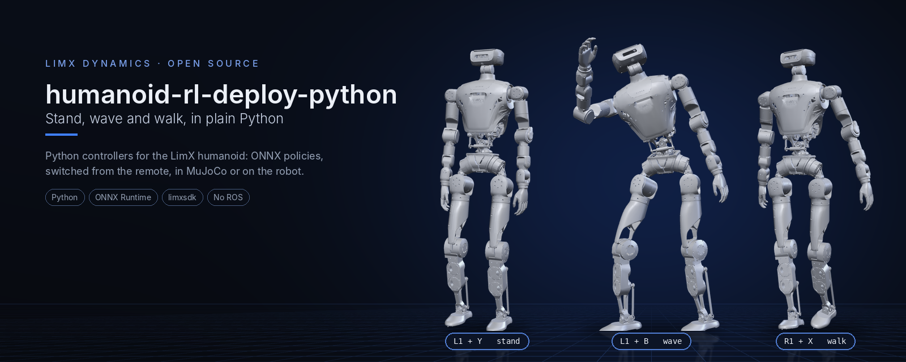
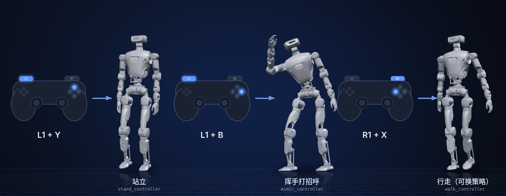

<p align="center">
  
</p>

<p align="center">
  <a href="README.md">English</a> | <b>中文</b>
</p>

<p align="center">
  <a href="LICENSE"></a>
  
  
  
</p>

# humanoid-rl-deploy-python

用纯 Python 把强化学习策略部署到 LimX 人形机器人：站立、挥手、行走三个控制器运行 ONNX 策略，
用遥控器切换，在 MuJoCo 仿真器和真机上都能跑。

> **范围：** 只负责部署端。策略在别处训练并导出为 ONNX；仿真器见
> [humanoid-mujoco-sim](https://github.com/limxdynamics/humanoid-mujoco-sim)。
> ROS 2 版本见 [humanoid-rl-deploy-ros2](https://github.com/limxdynamics/humanoid-rl-deploy-ros2)。

## 亮点

- **不需要 ROS，不需要编译。** 只要 Python 3、`limxsdk` 和 ONNX Runtime，运行 `main.py` 即可。
- **遥控器切换模式。** `L1 + Y` 站立，`L1 + B` 打招呼，`R1 + X` 行走，`L1 + A` 阻尼。
- **可换上自己的行走策略。** 把 `policy.onnx` 放进 `walk_controller/policy/default/`，控制器会把摇杆速度指令输入给它。
- **一个控制器一个文件。** 每个模式都是一个小的 `BaseAbility` 类（80 到 340 行），在 `controllers/<ROBOT_TYPE>/controllers.yaml` 中登记。
- **仿真和真机同一份代码。** `main.py` 默认连接 `127.0.0.1`，真机用 `main.py 10.192.1.2`。

## 支持的机器人

| | 型号 | 说明 | 控制器 | 策略格式 |
|:-:|---|---|---|---|
|  | `HU_D04_01` | 全尺寸人形机器人，31 个关节 | stand、mimic（打招呼）、walk、damping | ONNX |
|  | `HU_D03_03` | 上一代，已停产 | stand、mimic（打招呼）、damping | ONNX |

## 效果

<p align="center">
  
</p>

## 快速开始

在仿真中运行，[humanoid-mujoco-sim](https://github.com/limxdynamics/humanoid-mujoco-sim) 与本仓库放在同一目录下（Linux x86_64）：

```bash
cd ~/limx_ws
pip install humanoid-mujoco-sim/limxsdk-lowlevel/python3/amd64/limxsdk-*.whl click
export ROBOT_TYPE=HU_D04_01

python humanoid-mujoco-sim/simulator.py            # 终端 1
python humanoid-rl-deploy-python/main.py           # 终端 2
humanoid-mujoco-sim/robot-joystick/robot-joystick  # 终端 3
```

在虚拟摇杆中按住 `Q`（L1）再按 `I`（Y）站立，然后按 `L`（B）挥手。`main.py` 通过
`limxsdk.ability.cli` 加载和切换控制器，该模块需要 `click`，但 limxsdk 的 wheel 不会自动安装它。

## 1、创建工作空间

 可以按照以下步骤，创建一个RL部署开发工作空间：

- 打开一个Bash终端。

- 创建一个新目录来存放工作空间。例如，可以在用户的主目录下创建一个名为“limx_ws”的目录：
  ```Bash
  mkdir -p ~/limx_ws
  ```
  
- 下载 MuJoCo 仿真器
  ```Bash
  cd ~/limx_ws
  git clone --recurse git@github.com:limxdynamics/humanoid-mujoco-sim.git
  ```
  
- 下载运动控制算法：
  ```Bash
  cd ~/limx_ws
  git clone git@github.com:limxdynamics/humanoid-rl-deploy-python.git
  ```
  
- 设置机器人型号：如果尚未设置，请按照以下步骤进行设置。
  - 设置机器人型号类型：

    ```
    echo 'export ROBOT_TYPE=HU_D04_01' >> ~/.bashrc && source ~/.bashrc
    ```

## 2、仿真调试

- 运行MuJoco 仿真器（推荐Pyhon 3.8 及以上版本）

  - 打开一个 Bash 终端。

  - 安装运动控制开发库：
    - Linux x86_64 环境
    
      ```bash
      cd ~/limx_ws
      pip install humanoid-mujoco-sim/limxsdk-lowlevel/python3/amd64/limxsdk-*.whl
      ```
    
    - Linux aarch64 环境
    
      ```bash
      cd ~/limx_ws
      pip install humanoid-mujoco-sim/limxsdk-lowlevel/python3/aarch64/limxsdk-*.whl
      ```
    
  - 运行 MuJoCo 仿真器：
    
    ```bash
    cd ~/limx_ws
    python humanoid-mujoco-sim/simulator.py
    ```

- 运行算法

  - 打开一个 Bash 终端。

  - 运行算法
    
    ```bash
    python humanoid-rl-deploy-python/main.py
    ```
    
    
  
- 虚拟遥控器：仿真的时候可以使用虚拟遥控器来操作机器人。以下是使用虚拟遥控器的具体步骤。

  - 打开一个 Bash 终端。

  - 运行虚拟遥控器

    ```
    ~/limx_ws/humanoid-mujoco-sim/robot-joystick/robot-joystick
    ```
    
    


  - 这时，您可以使用虚拟遥控器来控制机器人。
  
    | **按键** | **模式**         | **说明**                                                    |
    | -------- | ---------------- | ----------------------------------------------------------- |
    | L1+Y     | 切换到站立模式   | 如机器人没法站立，请点击MuJoco界面中的“Reset”进行复位一下。 |
    | L1+B     | 切换到打招呼模式 |                                                             |
    | R1+X     | 切换到行走模式|   **这个模式可以选择使用自己训练的模型!**  |


- 部署自己训练的模型（可选）
  - 将您自己训练的策略模型导出为 ONNX 格式，命名为 `policy.onnx`。

  - 将 `policy.onnx` 文件放到部署工程代码的以下目录中：
    ``` sh
    limx_ws/humanoid-rl-deploy-python/controllers/HU_D04_01/walk_controller/policy/default
    ```

  - 根据上述步骤启动仿真器以及控制机器人。

  - 确保您的模型在仿真器中能正常运行再进行真机部署！


## 3、真机调试

- 设置您电脑IP：确保您的电脑与机器人本体通过外置网口连接。设置您的电脑IP地址为：`10.192.1.200`，并通过Shell命令`ping 10.192.1.2` 能够正常ping通。如下图所示对您的开发电脑进行IP设置：

  

- 机器人准备工作：

  - 请通过机器人左右肩膀的挂钩把机器人吊起来。
  - 按电源键开机后，按下遥控器`右摇杆`按键，启动机器人电机。
  - 按下遥控器按键 `R1 + DOWN`切换到开发者模式。在此模式下，用户可以开发自己的运动控制算法。（此模式设置后，下次开机继续生效，如需退出开发者模式请按`R1 + LEFT`退出）。

- 实机部署运行。在Bash终端只需下面Shell命令启动控制算法：

  ```bash
  python humanoid-rl-deploy-python/main.py 10.192.1.2
  ```
  
- 这时您可以通过遥控器按键`L1 + △（Y）`让机器人进入站立模式。

- 遥控器按`L1 + 〇（B）`控制机器人打招呼。

- 遥控器按`R1 + 口（X）`控制机器人行走。

## 4、技术文档

- [并联关节映射说明](doc/parallel_joint_mapping_cn.md)：踝部、腰部并联机构的 PR/AB 关节空间映射与 SDK 转换机制说明。

## 5. 控制器

`main.py` 加载 `controllers/$ROBOT_TYPE/controllers.yaml` 中的全部控制器，并在收到以下按键时切换：

| 按键 | 启动 | 说明 |
|---|---|---|
| `L1 + Y` | `stand` | 过渡到站立姿态 |
| `L1 + B` | `mimic` | 播放打招呼动作（策略 + 两个编码器） |
| `R1 + X` | `walk` | 摇杆速度指令，仅 HU_D04_01 |
| `L1 + A` | `damping` | 所有关节只加阻尼 |
| `L1 + X` | 无 | 停止全部控制器 |

行走策略输入最近 5 帧、每帧 102 维的观测（角速度、重力投影、速度指令、关节位置与速度、上一步动作），
输出 31 个关节目标；见 `walk_controller/walk_controller.py` 和 `walk_param.yaml`。

## 许可证

Apache License 2.0，见 [LICENSE](LICENSE)。
